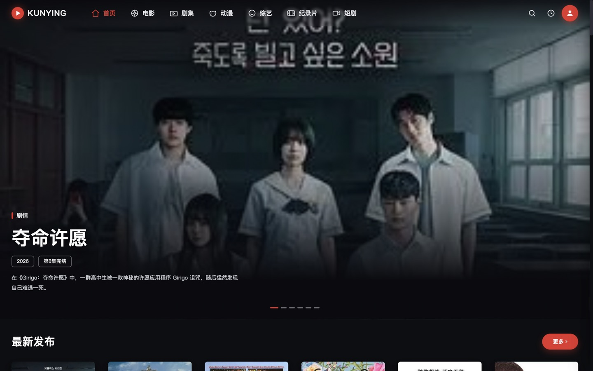
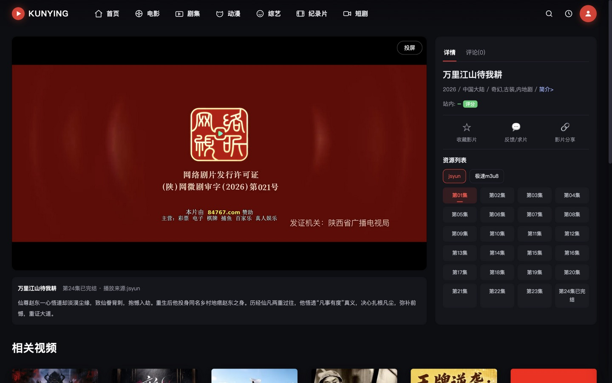
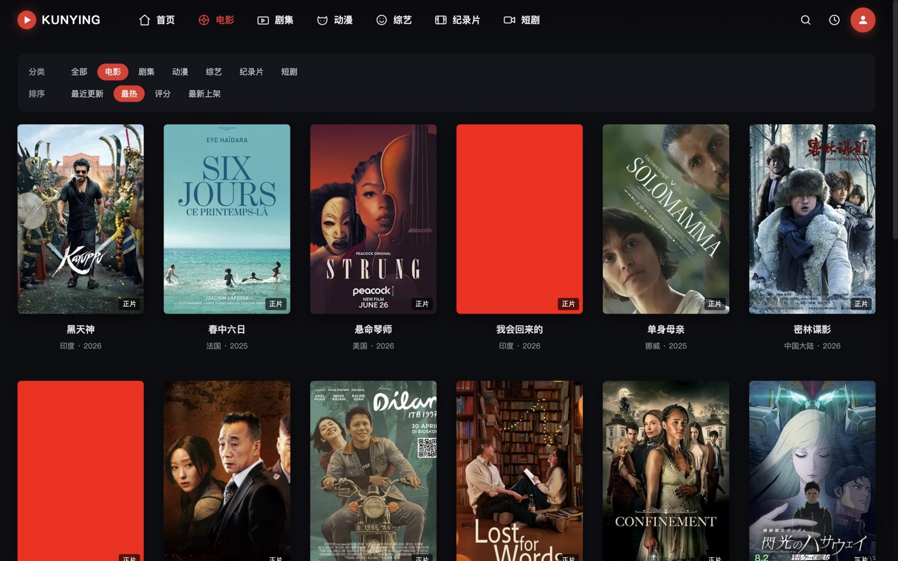
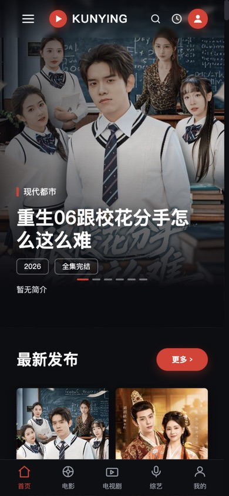
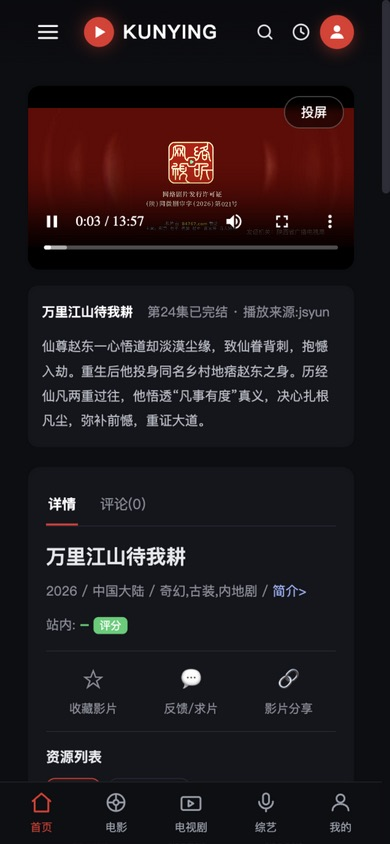

<div align="center">

# 🎬 坤影CMS (KunYing CMS)

**全新一代影视内容管理系统**

兼容苹果CMS v10 资源接口 · 内置采集中心 · 会员支付体系 · 三套主题

[](https://github.com/kungec/kunying-cms/releases)
[](https://www.php.net/)
[](https://github.com/kungec/kunying-cms/actions/workflows/ci.yml)
[](#-授权说明)
[](docs/Windows部署指南.md)

**傻瓜式一键安装 · 内置采集 · 电影海报墙 · 多主题切换 · 手机自适应**

</div>

---

## ✨ 简介

坤影CMS 是一套精心打磨的影视内容管理系统，兼容苹果CMS v10 标准资源接口。

内置采集中心、多主题模板体系、播放器投屏/选集/线路切换、会员/VIP/积分支付体系、
搜索联想、评论审核、页面缓存加速等完整功能，开箱即用。

历经多轮**专业渗透测试**与**真实站点大规模采集验证**（4.6万+ 影片），
安全与性能均经过实战检验。

## 🚀 核心特性

### 📺 内容与播放

- **多播放线路**：影片多来源播放地址自动合并，线路/剧集即时切换，故障自动换线
- **投屏**：移动端自动搜索同一WiFi下的电视设备（Remote Playback / AirPlay）
- **搜索联想**：输入即搜，同类型影片海报卡片下拉实时推荐
- **观看历史**：本地记录 + 云端同步双记录
- **电影海报墙**：全站视频统一电影海报模式展示（竖版2:3封面+评分+居中片名）
- **全屏大图幻灯**：后台幻灯管理可自定义大图轮播，支持指定数据源与数量
- **JSON-LD视频富摘要**：搜索引擎富摘要 + 百度自动推送 + RSS订阅 + sitemap

### ⚡ 采集中心

- **苹果CMS v10 接口兼容**：内置多个可用资源接口，也可自行添加
- **多进程采集**：CLI 支持 1~8 进程按「接口×页」分片并行，整库采集提速数倍
- **并发封面下载**：页内封面 8 路并发下载，采集耗时大幅缩短
- **封面自动压缩**：入库自动重编码（实测178KB→29KB，省84%），支持历史封面批量瘦身
- **智能去重**：同名影片自动合并播放地址、按集数URL增量去重、封面不重复下载
- **定时采集**：按设定间隔自动采集近12小时更新，支持温和/慢速/标准/极速速度档位
- **采集自愈**：单页失败自动重试退避，连续失败才停止；磁盘看门狗防写满

### 💾 存储灵活

- **封面存储可配置**：本站目录 / FTP / 阿里云OSS / S3兼容(MinIO/B2/COS)
- **云盘直存外链**：上传失败自动回退本地，采集永不中断
- **后台一键探针**：测试存储配置连通性

### 👥 会员体系

- **会员/积分/VIP**：充值套餐、积分签到、VIP专享影片、单片积分解锁
- **支付**：易支付 / 码支付 / USDT-TRC20免挂 / 微信官方 / 支付宝官方 / 支付宝当面付
- **回调金额比对**（±0.01）+ 原子入账 + 行锁防双花

### 🔐 安全加固（多轮渗透测试验证）

- 全参数 PDO 预处理、CSRF Token 全覆盖、XSS 过滤、SSRF 防护
- 付费主题解密密钥授权下发（未授权站点无法解密执行）
- 管理员会话令牌绑定密码哈希（改密即踢全部旧会话）
- 评论审核、搜索限频、后台登录锁定、邮箱验证码防爆破
- 转发节点网段信任（防 XFF 伪造绕过限流）

### ⚙️ 性能优化

- **页面缓存**：游客页面缓存 + 后台操作自动失效，详情页毫秒级打开
- **播放优化**：视频分片流式透传、播放列表磁盘缓存、分片并行加载
- **页面切换特效**：顶部进度条 + 页面淡入（三主题+后台）
- **封面WebP级压缩** + 静态资源30天强缓存
- **OPcache 深度优化**，全库常驻内存，零慢查询

### 🪟 跨平台

- **Linux**（宝塔/Docker）与 **Windows**（phpstudy/IIS）双平台完整支持
- 定时任务、多进程采集、数据库备份全部跨平台兼容
- 纯PHP数据库备份引擎（免mysqldump依赖）

## 📸 界面预览

**桌面端首页(全屏幻灯+电影海报墙)**


**播放页(多线路/选集/自动换线)**


**分类筛选页**


**移动端(底部Tab栏/自适应)**
 

## 📦 环境要求

| 项目 | 要求 |
|---|---|
| PHP | 7.4+（推荐 8.0-8.2，启用 OPcache 更佳） |
| 数据库 | MySQL 5.7+ / 8.0 |
| PHP扩展 | pdo_mysql、curl、gd、mbstring、zip、fileinfo、openssl |
| Web服务 | Nginx / Apache / IIS（伪静态可选） |

> 🪟 **支持 Windows 部署**(phpstudy/IIS+PHP+MySQL)：定时任务、多进程采集、数据库备份全部跨平台兼容，详见 [Windows部署指南](docs/Windows部署指南.md)。

## 🛠 一键安装教程

### 1. 上传程序
将程序文件上传至网站根目录（如 `/www/wwwroot/你的域名/`）。

### 2. 访问域名
浏览器打开 `https://你的域名/`，自动进入安装向导：

- **第1步 环境检测**：程序自动检查 PHP 版本、扩展与目录权限
  （所有工作目录自动创建并索要 755 权限，一般无需手工操作）
- **第2步 配置数据库**：填写数据库地址/账号/密码与管理员账号密码
  （数据库不存在会自动创建）
- **第3步 安装完成**：自动建库建表+写入默认数据（分类/幻灯/采集源/播放器）

> 安装完成后程序会**自动删除 `install` 目录**(若个别环境权限不足删除失败,完成页会提示手动删除)。

### 3. 伪静态（可选但推荐）
Nginx 参考（宝塔用户在网站设置-伪静态中添加）：
```nginx
# ---- 安全防护(必须放在最前面) ----
location ~* ^/(ky|data)/ { deny all; }
location ~* ^/(theme|addon)/.*\.php$ { deny all; }
location ~* ^/upload/.*\.(php|phtml|phar)$ { deny all; }
# ---- 伪静态 ----
location / { try_files $uri $uri/ /index.php?s=$uri&$query_string; }
rewrite ^/detail-(\d+)\.html$ /index.php?s=/vod/detail&id=$1 last;
rewrite ^/type-(\d+)\.html$ /index.php?s=/vod/type&id=$1 last;
```
开启方法：后台 → 系统设置 → 伪静态URL → 开启。

### 4. Docker 部署
```bash
docker-compose up -d
```

## 🎨 主题体系

| 主题 | 说明 | 费用 |
|---|---|---|
| **kylite**（默认） | 浅色简洁风格，白卡片海报墙，手机自适应 | 免费 |
| **KUNPRO** | 星辰影院风格：展开式导航+全屏大图幻灯+电影海报墙 | 专业版 |
| **爱奇艺风格** | 大图幻灯+横竖混排信息流，海报大卡沉浸浏览 | 专业版 |

后台 → 系统设置 → 默认模板 中一键切换。

## 💎 专业版（99元 永久）

开通专业版会员，**全部付费主题与付费插件免费使用**。

**开通方式**：前往授权站购买专业版 → 获取激活码 → 后台 拓展→市场→激活码激活

**域名绑定规则**：
- 使用主域名（`xxx.com` 或 `www.xxx.com`）：激活后 **www 与裸域名均可使用**
- 使用子域名（如 `ys.xxx.com`）：仅该子域名可用

## 📡 采集教程

1. 后台 → 采集中心 → 采集管理（已内置多个可用资源接口，也可自行添加）
2. 点击接口地址**进入接口详情页**：自动拉取资源站全部分类
3. 点击分类查看该分类资源列表 → 选择采集范围（全量/近24小时等）→ 开始采集
4. 采集速度可在 温和/慢速/标准/极速 间切换（防封IP请用温和模式）
5. 定时采集：开启后按设定间隔自动采集近12小时更新

**去重说明**：同名影片自动合并播放地址；封面已存在的影片不再重复下载；
播放地址按集数URL增量去重，已有地址绝不重复写入。

## ⏰ 定时任务(Cron)

开启后台"定时采集"后，添加系统Cron(宝塔:计划任务-Shell脚本)：
```bash
# 定时采集(推荐每30分钟,与后台设置保持一致)
/php/82/bin/php /www/wwwroot/你的域名/ky/cron/collect.php > /dev/null 2>&1
# 数据库备份(纯PHP跨平台,免mysqldump;保留最近7份)
/php/82/bin/php /www/wwwroot/你的域名/ky/cron/backup.php
# 封面批量压缩(历史大图瘦身,跑完自动停止)
/php/82/bin/php /www/wwwroot/你的域名/ky/cron/imgopt.php --limit=2000
```
后台可设采集间隔与更新范围(近12小时)，配合速度档位避免触发资源站限制。

> 🪟 Windows 用户使用「任务计划程序」配置相同命令，详见 [Windows部署指南](docs/Windows部署指南.md)。

## 📂 目录结构

```
├── index.php              # 入口文件
├── admin.php              # 后台入口
├── install/               # 一键安装向导(装完可删)
├── ky/
│   ├── Controller/        # 控制器(前台/后台)
│   ├── Lib/               # 类库(Db/Http/License/Collector/Store…)
│   ├── View/              # 后台视图
│   ├── cron/              # 定时任务脚本(采集/备份/封面压缩)
│   ├── Func.php           # 全局函数(缓存/主题运行时/工具)
│   └── Core.php           # 路由与内核
├── theme/
│   ├── kylite/            # 默认主题(开源) 浅色海报墙
│   ├── kunpro/            # 付费主题(加密) 星辰影院风格
│   └── iqiyi/             # 付费主题(加密) 爱奇艺风格
├── static/                # 全局静态资源
├── upload/vod/            # 采集图片本地化目录
├── data/                  # 缓存/配置(自动生成)
├── docker-compose.yml     # Docker编排
└── Dockerfile
```

## ❓ 常见问题

**Q: 在线安装主题提示创建目录失败？**
安装程序已自动配置目录权限。如仍失败，请 SSH 执行：
`chown -R www:www 网站根目录 && chmod -R 755 网站根目录`

**Q: 某个片源播放不了？**
播放器会自动按资源站规律修复播放页地址；同一影片一般有多个线路，
请在播放页右侧"资源列表"切换其他线路。

**Q: 缓存如何清理？**
后台右上角"🧹 清理缓存"一键清理；修改任何内容后缓存自动失效。

**Q: 搜索页的热门推荐是怎么排的？**
按影片被搜索次数实时排名（有人搜就靠前）；全新站点无人搜索时随机展示。

## 🙏 特别鸣谢

**本项目的赞助商：**

### [跨境VPS · www.kjvps.com](https://www.kjvps.com/)

感谢「跨境VPS」对本项目开发的大力支持！

## 📋 更新日志

### ✨ v1.0.39 亮点

- ⚡ **采集提速**：页内封面 curl_multi 8路并发下载 + CLI多进程分片(1~8进程)
- 💾 **图片存储可配置**：本站/FTP/OSS/S3兼容，云盘直存外链，失败自动回退本地
- 🖼 **封面自动压缩**：入库重编码宽≤480px(省84%)，存量45664张批量瘦身880MB
- 🎬 **播放卡顿治理**：代理层session锁释放、分片真流式透传、播放列表磁盘缓存
- 🧭 **分类主/副分级**：主分类上导航栏，副分类进所属主分类下拉(三主题同步)
- 🔍 **搜索热门按被搜次数排名**：无人搜索时随机兜底
- 🪟 **Windows部署兼容**：多进程NUL设备适配+纯PHP跨平台数据库备份
- 🔐 渗透测试加固：XFF伪造绕过限流修复、progress接口补CSRF、HSTS、验证码接口限流
- 🎨 登录/注册/忘记密码页紧凑化；kunpro忘记密码页错位修复；kunpro无用悬浮球移除
- 📖 全新Windows部署指南(docs/Windows部署指南.md) + IIS伪静态样例

<details>
<summary><b>v1.0.38 (2026-10-12)</b> — 极验致命修复+认证页紧凑化</summary>

- 🐛 极验服务端校验域名下线导致登录全面阻断 → 切换官方现行端点+gen_time
- 📐 极验收起条与表单输入框对齐；滑块UI回归原生渲染
- 🎨 登录/注册/忘记密码页紧凑化(三主题)

</details>

<details>
<summary><b>v1.0.37 (2026-10-12)</b> — 全主题深度安全审计</summary>

- 🔐 三主题解密逐模板审计；付费主题播放页空源守卫、联想字段转义
- 🛠 iqiyi补齐忘记密码页与观看历史样式；kunpro播放页空源守卫
- ⚡ 导航分类查询缓存化

</details>

<details>
<summary><b>v1.0.36 (2026-10-12)</b> — 致命缺陷修复</summary>

- 🔴 main.js从未被加载(AJAX全失效) → 补script引入
- 🟠 jsonPost增加$_POST回退(收藏/评论/积分解锁/充值下单修复)
- 🔍 搜索联想全站生效；用户中心补账号设置标签

</details>

<details>
<summary><b>历史版本 (v1.0.20 ~ v1.0.35)</b></summary>

**v1.0.35 (2026-09-24)**
- 🎬 kylite首页搜索横幅改为全屏幻灯轮播(背景大图+片名+立即播放)
- 🔍 搜索框移至header右上角(紧凑设计+联想下拉)
- 🎨 CSS全面打磨(卡片光晕/渐入动画/搜索栏重设计)
- 📱 PWA支持(添加到主屏幕) | 🔍 JSON-LD视频富摘要+百度自动推送
- 💾 每日数据瘦身+磁盘看门狗

**v1.0.33 (2026-09-23)**
- 🎨 kylite默认主题大规模视觉重设计：全新设计系统+暗色模式+玻璃拟态导航+微交互动画
- 📱 移动端PWA支持+底部Tab栏 | 🔍 JSON-LD视频结构化数据+百度自动推送+RSS订阅
- 💾 磁盘深度清理(释放12GB)+采集源参数修复(CI-E2E发现)

**v1.0.30 (2026-09-22)**
- ✨ 求片系统
- 📱 PWA支持(添加到主屏幕)

**v1.0.29 (2026-09-23)**
- ✨ 百度链接自动推送：新影片采集上线后自动实时推送至百度收录接口

**v1.0.28 (2026-09-23)**
- 🔍 播放页新增JSON-LD视频结构化数据：搜索引擎富摘要、缩略图绝对地址

**v1.0.27 (2026-09-23)**
- 🐛 PHP 7.4完整兼容修复：6处PHP 8专属函数散布在采集/代理/重定向/插件安装/更新校验核心路径，已全部替换
- 🏗 CI新增PHP7.4兼容性函数扫描守卫

**v1.0.26 (2026-09-23)**
- 🐛 重要修复：定时采集逻辑恢复+磁盘看门狗

**v1.0.25 (2026-09-22)**
- 🐛 修复默认采集源参数缺失导致的全新安装失败(CI-E2E发现)

**v1.0.24 (2026-09-22)**
- 🧪 CI新增全新安装E2E验证

**v1.0.23 (2026-09-22)**
- 🏗 GitHub Actions CI+数据运维自动化+README截图

**v1.0.22 (2026-09-22)**
- 🐛 修复图片自动清理从未实际执行的问题，接入每日定时任务

**v1.0.21 (2026-09-22)**
- 🔧 仓库结构清理，版本号规范同步

**v1.0.20 (2026-09-22)**
- ✨ 用户中心新增账号设置：自助修改昵称与修改密码，双主题同步

**v1.0.19 (2026-09-22)**
- ✨ 新增忘记密码/自助找回：登录页入口→注册邮箱收重置码→设置新密码
- 防刷齐备：同邮箱1分钟1条/10分钟3条、重置尝试10次/10分钟、重置码一次性消费

**v1.0.18 (2026-09-22)**
- 🔍 SEO全家桶：内置sitemap站点地图、robots.txt、OG分享卡片

**v1.0.16 (2026-09-22)**
- ✨ 默认主题kylite新增手机底部Tab栏，与付费主题功能对齐

**v1.0.15 (2026-09-22)**
- 🔒 后台所有POST操作统一增加CSRF Token服务端校验

**v1.0.14 (2026-09-22)**
- 🐛 修复图片自动清理功能从未实际执行的缺陷；移除5000张扫描上限

**v1.0.13 (2026-09-22)**
- 🐛 完善线路自动切换：换线保持当前集数；自动钳制到末集

**v1.0.12 (2026-09-22)**
- ✨ 播放器新增线路故障自动切换；修复播放器资源版本号引用错误

**v1.0.11 (2026-09-22)**
- ⚡ 播放页hls.js与播放器JS改为defer异步加载，消除慢线路白屏

**v1.0.10 (2026-09-22)**
- ⚡ 修复观看视频后返回首页卡顿(播放页后台探测前未释放会话锁)

**v1.0.9 (2026-09-22)**
- 🔐 付费主题保护机制升级：解密密钥改为授权验证通过后由控制端下发

**v1.0.8 (2026-09-22)**
- ✨ KUNPRO首页幻灯新增点击进入影片；修复拖拽手势对点击的影响

**v1.0.7 (2026-09-22)**
- 🐛 修复采集起始页显示错乱；按时间筛选时自动重置起始页

**v1.0.6 (2026-09-22)**
- 🐛 修复快速采集连续35~40页后停止的问题；采集循环自愈能力

**v1.0.5 (2026-09-22)**
- 📱 KUNPRO主题首页幻灯新增手动滑动(指针拖拽+跟手反馈)

**v1.0.4 (2026-09-22)**
- 🛡 安装完成后自动删除install目录

**v1.0.3 (2026-09-22)**
- 🐛 签到接口并发竞态修复；补充CSRF校验

**v1.0.2 (2026-09-22)**
- 🔒 支付回调金额比对(±0.01)；定时采集仅CLI；安全防护规则

**v1.0.0 (2026-09)**
- 首个开源版本：3套主题(1开源+2付费加密)、采集中心、会员支付体系、页面缓存

</details>

## 📄 授权说明

本项目程序主体供学习交流使用。请勿用于任何违法违规用途，
影视内容均来自互联网收集，版权归原作者所有，如有侵权请联系删除。
